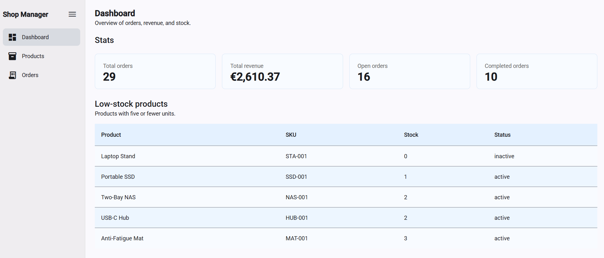
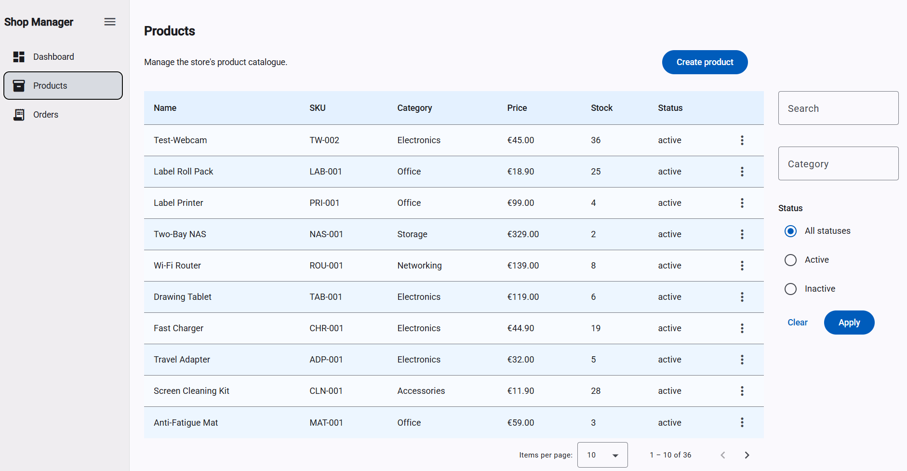
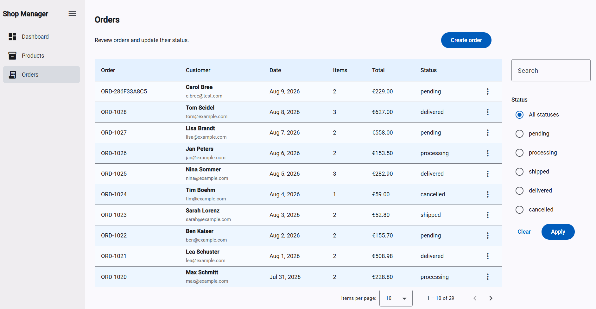

# Store Admin Dashboard

This is a demo e-commerce administration application built with Angular, FastAPI, and PostgreSQL. It implements product and order management, store metrics, CRUD workflows, and server-side filtering and pagination. The project serves as a technical demonstration and is not intended for production use.

## Table of Contents

- [Features](#features)
- [Screenshots](#screenshots)
- [Tech Stack](#tech-stack)
- [Architecture](#architecture)
- [Running Locally](#running-locally)
- [Project Status](#project-status)

## Features

### Dashboard

- Store overview with order and revenue metrics
- Low-stock product table
- Loading, empty, and error states

### Products

- Create, view, update, and delete products
- Product detail page
- Search by name or SKU
- Filter by category and status
- Server-side pagination
- Action menu for row-level operations

### Orders

- Create orders with multiple products
- Order detail page with line items
- Search by order number or customer
- Filter by status
- Server-side pagination
- Update order status from an action menu

## Screenshots

### Dashboard



### Products



### Orders



## Tech Stack

- Frontend: Angular, TypeScript, Angular Material, RxJS
- Backend: Python, FastAPI, SQLAlchemy, Pydantic, Alembic
- Database and tooling: PostgreSQL, Docker Compose

## Architecture

The backend follows a simple layered structure:

```text
Router -> Service -> Repository -> Database
```

The frontend is organized around routed pages, shared models, and API services:

```text
Pages -> Services -> API
```

## Running Locally

The app runs with Docker Compose. Startup builds the frontend/backend, runs migrations, seeds demo data, and starts PostgreSQL, FastAPI, and Nginx.
Clone the repository and create the local environment file:

```bash
cp .env.example .env
```
Start the application:
```bash
docker compose up --build
```

Once running:

- Frontend: `http://localhost:4200`
- API documentation: `http://localhost:8000/docs`
- API health check: `http://localhost:8000/health`
- Database health check: `http://localhost:8000/health/database`

## Project Status

Planned improvements:

- Automated test coverage
- Additional dashboard metrics
